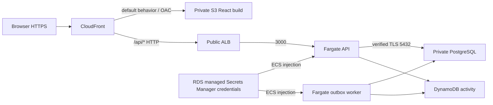

# AWS architecture

Phase 7 preserves the Product, Content, Auth, transactional outbox, DynamoDB activity repository and optional Redis architecture. Terraform owns every AWS resource. Bootstrap owns immutable ECR; environment owns the application infrastructure. Region defaults to `ap-south-1`. Tags are `Project=cloudops-content-platform`, `Environment=demo`, `ManagedBy=terraform`.

## Network boundaries

Two AZs each have a public subnet and isolated database subnet. Only public subnets route to the internet gateway. API, worker and one-off migrations receive public IPv4 addresses for ECR, CloudWatch, Secrets Manager and DynamoDB connectivity. No NAT Gateway or paid VPC endpoints are created. The task port is reachable only from the ALB security group. RDS permits 5432 only from the task security group and has no public endpoint or internet route. Task outbound traffic is restricted to HTTPS and PostgreSQL; VPC resolver DNS uses the AWS-provided resolver.

The ALB allows HTTP only from the AWS-managed CloudFront origin-facing prefix list. This list has substantial security group quota weight (55); increase the quota if required rather than widening ingress. The stack fails if the list is unavailable. This restriction covers all CloudFront distributions, not just this distribution. API authentication, authorization and CSRF remain enforced at Express. CloudFront-to-ALB is HTTP by the accepted demo design; database connections use verified TLS with the AWS RDS trust bundle.

## Browser routing and authentication

One CloudFront distribution uses the default HTTPS certificate and redirects HTTP viewers to HTTPS. Private S3 uses Origin Access Control with a bucket policy restricted to this distribution. `/api/*` targets the ALB with `Managed-CachingDisabled` and `Managed-AllViewerExceptHostHeader`, forwarding cookies, authorization, Origin and CSRF headers and allowing all seven requested HTTP methods. Error-cache TTLs are zero, with no response-code or page substitution. API errors, including 404s, retain their status and JSON body.

The SPA viewer-request function runs only on the default frontend behavior. Extensionless routes and trailing slashes become `/index.html`; assets retain their paths. Production browser API URLs are relative. The Vite local proxy remains intact. Express trusts the immediate hop only if it is in `10.42.0.0/24` or `10.42.1.0/24` (the ALB subnets), and the next hop only if it is in the managed CloudFront origin prefix list supplied by Terraform. It never trusts further hops, so viewer-supplied X-Forwarded-For entries cannot replace the viewer address used for rate limiting. It does not trust viewer-supplied protocol headers to decide cookie security: existing production cookies explicitly use Secure, HttpOnly, SameSite=Lax, path=/ and the `__Host-` prefix. Session and CSRF secrets are generated per session and stored hashed in PostgreSQL; no additional global session secret is needed.

## Runtime and storage

A single multi-stage Node 24 image installs locked dependencies, compiles TypeScript, and runs production dependencies as the non-root node user. It contains migrations and the public RDS CA bundle but no seeds, environment files or credentials. API, worker and migration task definitions use distinct commands with the same release image. ECS init handles orphaned children; SIGTERM is delivered to Node and existing graceful shutdown logic drains the API and worker. API tasks have readiness health checks and a read-only root filesystem.

API and worker use separate 0.25-vCPU/512-MiB tasks to avoid contention at minimum sizing. Counts are zero until controlled migrations succeed; enabling services sets each to one. Rolling replacements permit one old and one new task, with circuit breaker rollback and an API health grace period. ECS Exec and autoscaling are disabled. Worker deployment health detects exits, while outbox delivery failures are retried by the existing worker and remain visible in its JSON logs.

RDS uses configurable PostgreSQL 16 and db.t4g.micro defaults, Single-AZ, encrypted gp3 storage (20 GiB, maximum 30), three-day automated backups, automatic minor upgrades and enforced TLS. RDS manages its master credential in Secrets Manager; Terraform never reads the secret value. ECS injects JSON `username` and `password` fields, while DB_HOST/PORT/NAME remain ordinary configuration. Production rejects mixed or incomplete database settings and requires a verified TLS CA. The demo uses the managed master user for API/worker/migrations; a restricted database application user is a future hardening option. RDS secret rotation requires replacement tasks because ECS environment injection occurs at task launch; redeploy both services after credential rotation.

DynamoDB uses PAY_PER_REQUEST, string `pk`/`sk`, and the `recent_activity` GSI with string `gsiPk`/`gsiSk` and ALL projection, exactly matching Phase 4. No Redis resource is provisioned. Missing REDIS_URL cleanly selects PostgreSQL reads.

## IAM, logs and cost

The execution role permits ECR authorization, pull from this repository, writes to these three log groups and retrieval of only the RDS secret. The application role permits only PutItem on this table and Query on this table and its exact GSI. Neither role has AdministratorAccess. RDS uses the default Secrets Manager service key, so additional customer-KMS decryption permissions are unnecessary. API, worker and migrations write structured JSON to bounded seven-day CloudWatch groups.

ALB hours/LCUs, two Fargate tasks, RDS hours/storage/backups, public IPv4 addresses, ECR, Secrets Manager, CloudWatch, S3, CloudFront and data transfer consume credits. Optional budget_email creates an account monthly cost alert at 80% of the configurable $30 budget. This is a notification, not a hard spending cap. No Multi-AZ RDS, NAT, ElastiCache, Lambda, Kubernetes, CI workflows or observability expansion are included.

## References

- [AWS CloudFront and ALB origin restrictions](https://aws.amazon.com/blogs/networking-and-content-delivery/optimizing-application-performance-the-strategic-benefits-of-combining-amazon-cloudfront-with-application-load-balancers/)
- [AWS managed origin request policies](https://docs.aws.amazon.com/AmazonCloudFront/latest/DeveloperGuide/using-managed-origin-request-policies.html)
- [AWS RDS TLS and certificate bundles](https://docs.aws.amazon.com/AmazonRDS/latest/UserGuide/UsingWithRDS.SSL.html)
